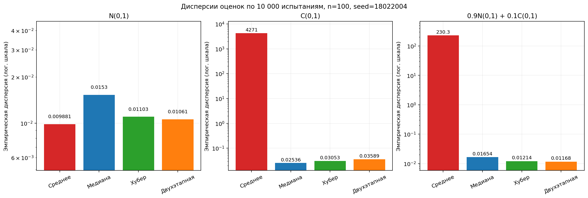
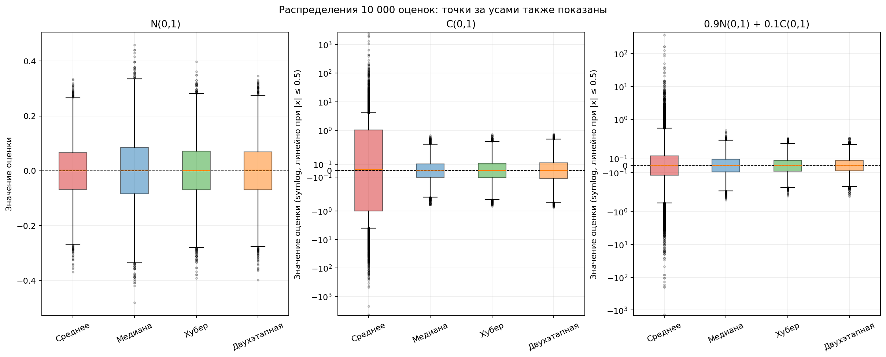

# Лабораторная работа 04_01

## Условие

1. Что такое свойство робастности статистических оценок и почему оно важно при обработке больших данных?
2. Положить количество испытаний 10 000 в методе Монте-Карло, сгенерировать выборки размера n=100 из стандартного нормального распределения N(0,1), распределения Коши C(0,1) и смеси 0.9N(0,1)+0.1C(0,1).
3. Получить средние и дисперсии по методу Монте-Карло для выборочного среднего, выборочной медианы, оценки Хубера с k=1.44 и двухэтапной оценки.
4. Провести анализ полученных результатов и сделать выводы.

## План решения

1. Зафиксировать генератор случайных чисел и параметры эксперимента.
2. Для каждого распределения независимо сгенерировать 10 000 выборок размера 100.
3. На каждой выборке вычислить четыре оценки одного и того же параметра положения θ=0.
4. Для каждой оценки найти среднее и эмпирическую дисперсию по 10 000 испытаниям.
5. Сопоставить результаты, построить графики и ответить на вопрос о робастности.

## Структура и запуск

Структура основана на [примере labs/05](https://github.com/azya0/big_data_2025/tree/main/labs/05): расчёты находятся в `main.py`, пояснения — в Markdown.

- `main.py` — генерация выборок, четыре оценки, эксперимент Монте-Карло, таблица и графики.
- `answer.md` — ответ о робастности и выводы по эксперименту.
- `requirements.txt` — зависимости.
- `results/results.csv` — средние и дисперсии 12 сочетаний «распределение — оценка», с параметрами эксперимента.
- `results/01_Дисперсии_оценок_Монте_Карло.png` — сравнение эмпирических дисперсий.
- `results/02_Распределения_оценок.png` — боксплоты значений оценок по всем испытаниям.

Из корня проекта:

```bash
python -m pip install -r labs/04_01/requirements.txt
.venv/bin/python labs/04_01/main.py
```

При обычном запуске в терминале программа рассчитывает результаты, сохраняет таблицу и изображения, затем открывает окна графиков. Для запуска без окон:

```bash
.venv/bin/python labs/04_01/main.py --save
```

При активированном виртуальном окружении вместо `.venv/bin/python` можно писать `python`. Интернет для расчётов не требуется. Повторный запуск воспроизводит эксперимент и обновляет CSV и изображения. Текст README и answer.md автоматически не перезаписывается.

## 1. Робастность

**Робастность — устойчивость статистической процедуры к умеренным отклонениям от принятой модели**, например к выбросам, загрязнению данных и более тяжёлым хвостам распределения. При таких изменениях оценка должна сохранять приемлемую точность. Робастность не гарантирует точную несмещённость и одинаковую эффективность при любом распределении.

Среднее арифметическое чувствительно к очень большим наблюдениям: одно такое значение способно сильно его сдвинуть. Медиана определяется центральными порядковыми статистиками и гораздо слабее реагирует на отдельные крайние значения.

При обработке больших данных объединяются разные источники, встречаются ошибки измерения, редкие события и изменение распределений. Увеличение объёма данных не исправляет автоматически неверные предположения о распределении. Поэтому полезны методы, устойчивые к загрязнению. В этой работе робастность изучается на примере нормальных данных, тяжёлых хвостов Коши и смеси с 10% загрязнения.

Краткие ответы и выводы также вынесены в [answer.md](answer.md).

## 2. Параметры эксперимента

| Параметр                                    | Значение |
| ------------------------------------------- | -------: |
| Число испытаний для каждого распределения N |   10 000 |
| Размер каждой выборки n                     |      100 |
| Число распределений                         |        3 |
| Общее число выборок                         |   30 000 |
| Параметр положения θ                        |        0 |
| Seed                                        | 18022004 |
| Порог Хубера k                              |     1.44 |
| Точность итераций Хубера                    |     10⁻⁶ |
| Максимальное число итераций Хубера          |      100 |

Как в примере, используется последовательность генератора `np.random.RandomState(18022004)`. Сначала проводятся все испытания N(0,1), затем C(0,1), затем смеси; генератор между распределениями не сбрасывается. Внутри каждой выборки четыре оценки вычисляются по одним и тем же данным.

**Смесь не является суммой двух случайных величин с весами.** Для каждого наблюдения независимо выбирается N(0,1) с вероятностью 0.9 или C(0,1) с вероятностью 0.1. Доля наблюдений Коши в отдельной выборке может отличаться от 10%.

Во всех трёх моделях оценивается **центр распределения θ=0**. Для Коши и смеси он определён как параметр положения и медиана, хотя математического ожидания у этих распределений нет.

## 3. Оценки параметра положения

**Выборочное среднее:** сумма 100 значений, делённая на 100.

**Выборочная медиана:** при чётном n=100 — полусумма двух центральных элементов упорядоченной выборки.

**Оценка Хубера:** начальное приближение — медиана, масштаб — медиана абсолютных отклонений от начальной медианы:

$$
s=\operatorname{median}_i|x_i-\operatorname{median}(x)|.
$$

Далее итерационно пересчитывается взвешенное среднее:

$$
u_i=\frac{x_i-\theta}{s},\qquad
w_i=\begin{cases}1,&|u_i|\leq1.44,\\1.44/|u_i|,&|u_i|>1.44,\end{cases}
\qquad
\theta_{\mathrm{new}}=\frac{\sum_i w_i x_i}{\sum_i w_i}.
$$

Как в коде примера, используется **MAD без нормирующего множителя 1.4826**, масштаб фиксирован на протяжении итераций. Это уточнение важно для воспроизведения чисел: при другом определении масштаба результаты Хубера изменятся. При нулевом MAD возвращается начальная медиана. Если сходимость не достигнута, программа сообщает об ошибке; в выполненном эксперименте все вычисления завершились успешно.

**Двухэтапная оценка**, согласно слайду «Двухэтапная оценка» лекции 16:

1. Найти Q₁ и Q₃ линейной интерполяцией, вычислить IQR=Q₃−Q₁ и исключить значения за пределами [Q₁−1.5·IQR; Q₃+1.5·IQR].
2. Вычислить среднее оставшихся наблюдений. Значения на границах сохраняются; повторная отбраковка не выполняется.

## 4. Средние и дисперсии Монте-Карло

Для каждой оценки получаются N=10 000 значений $\hat\theta_1,\ldots,\hat\theta_N$. Их характеристики вычисляются по формулам лекции:

$$
\overline{\hat\theta}_{MC}=\frac1N\sum_{j=1}^{N}\hat\theta_j,\qquad
D_{MC}=\frac1N\sum_{j=1}^{N}(\hat\theta_j-\overline{\hat\theta}_{MC})^2.
$$

Для дисперсии используется делитель **N**, то есть `ddof=0`. Формула с центрированием численно устойчивее разности второго момента и квадрата среднего и математически ей эквивалентна. Поскольку θ=0, среднее Монте-Карло также показывает эмпирическое отклонение от заданного центра.

| Распределение | Оценка      |  Среднее МК |  Дисперсия МК |
| ------------- | ----------- | ----------: | ------------: |
| N(0,1)        | Среднее     | −0.00029294 |    0.00988053 |
| N(0,1)        | Медиана     |  0.00008831 |    0.01530414 |
| N(0,1)        | Хубер       |  0.00017312 |    0.01102583 |
| N(0,1)        | Двухэтапная | −0.00010473 |    0.01060865 |
| C(0,1)        | Среднее     |  0.13023368 | 4270.54948328 |
| C(0,1)        | Медиана     | −0.00159979 |    0.02535773 |
| C(0,1)        | Хубер       | −0.00157034 |    0.03053033 |
| C(0,1)        | Двухэтапная | −0.00135602 |    0.03589174 |
| 0.9N+0.1C     | Среднее     | −0.14527717 |  230.25659771 |
| 0.9N+0.1C     | Медиана     | −0.00202279 |    0.01654164 |
| 0.9N+0.1C     | Хубер       | −0.00206270 |    0.01214064 |
| 0.9N+0.1C     | Двухэтапная | −0.00216684 |    0.01167944 |

Полные числовые результаты сохранены в [results.csv](results/results.csv).

**Особенность интерпретации:** у распределения Коши математическое ожидание и дисперсия не определены; см. [справочник NIST](https://www.itl.nist.gov/div898/handbook/eda/section3/eda3663.htm). У выборочного среднего Коши и среднего смеси с положительной долей Коши эти моменты также не существуют. Для них приведённые числа — характеристики конкретного конечного набора из 10 000 оценок, а не приближение к существующим теоретическим среднему и дисперсии. При другом seed или числе испытаний они могут резко меняться.

Близкое к нулю среднее Монте-Карло само по себе не доказывает несмещённость. Для корректного утверждения о несмещённости нужны свойства распределения оценки и существование её математического ожидания.

## 5. Графики и анализ результатов



Вертикальные оси логарифмические, пределы осей для трёх панелей различаются. Над столбцами указаны значения из эксперимента. Большие столбцы среднего для Коши и смеси отражают неустойчивость конечной эмпирической дисперсии, а не существование теоретической дисперсии.



Каждый боксплот построен по 10 000 значениям одной оценки, а не по одной выборке из 100 наблюдений. Для Коши и смеси используется симметричная логарифмическая шкала: около нуля, при |x|≤0.5, шкала линейная, дальше логарифмическая. Это позволяет одновременно показать центральную часть и крайне большие значения среднего. Точки за усами не скрываются.

### Нормальное распределение

У среднего минимальная эмпирическая дисперсия **0.009881**, близкая к теоретической 1/n=0.01. Далее идут двухэтапная оценка **0.010609**, Хубер **0.011026** и медиана **0.015304**. Все средние МК близки к центру 0. При чистых нормальных данных устойчивость к загрязнению сопровождается некоторой потерей эффективности по сравнению с обычным средним.

### Распределение Коши

Выборочное среднее сильно реагирует на крайние наблюдения: дисперсия конечного эксперимента равна **4270.549483**. Среди трёх робастных оценок минимальная дисперсия у медианы — **0.025358**, затем у Хубера — **0.030530**, затем у двухэтапной — **0.035892**. Средние МК робастных оценок близки к 0. В этом эксперименте медиана лучше остальных исследованных оценок переносит чистое распределение с очень тяжёлыми хвостами.

### Смесь 0.9N(0,1)+0.1C(0,1)

Даже 10% загрязнения Коши делают обычное среднее неустойчивым: эмпирическая дисперсия равна **230.256598**. У робастных методов она остаётся малой. В данном эксперименте лучший результат у двухэтапной оценки — **0.011679**, далее Хубер — **0.012141**, затем медиана — **0.016542**. Хубер и двухэтапная оценка дают удачный компромисс между эффективностью на нормальных данных и устойчивостью к загрязнению.

### Общий вывод

Универсального победителя нет: для N(0,1) предпочтительно среднее, для чистого Коши — медиана, для исследованной смеси — двухэтапная оценка. При неизвестной форме распределения и возможном загрязнении Хубер и двухэтапная оценка являются полезными вариантами. Выводы о численном ранжировании относятся к n=100, выбранным параметрам оценок и выполненному эксперименту.

## 6. Сравнение с примером и answer.md

Исходная [программа](https://github.com/azya0/big_data_2025/blob/main/labs/05/main.py) отдельно скачана во временную папку и запущена для сравнения. Все 12 пар «среднее — дисперсия» совпадают с её выводом при округлении до четырёх знаков. Сохранены число испытаний, размер выборки, seed, порядок генерации, k=1.44, ненормированный MAD и правило отбраковки Тьюки. В нашей реализации также проверяются сходимость Хубера и конечность результатов, исключено деление на ноль при расчёте весов, добавлены CSV и графики.

Файл [answer.md из примера](https://github.com/azya0/big_data_2025/blob/main/labs/05/answer.md) прочитан и сопоставлен с расчётами. Его основные качественные выводы и приведённые дисперсии для нормального распределения подтверждаются. Однако определение робастности как обязательного сохранения эффективности и несмещённости слишком сильное; конечная симуляция не доказывает несмещённость; у среднего Коши теоретические моменты не существуют. Поэтому **условие полного совпадения корректных ответов не выполнено**: файл не скопирован дословно. В нашем [answer.md](answer.md) приведены ответы с этими уточнениями и числами эксперимента.
