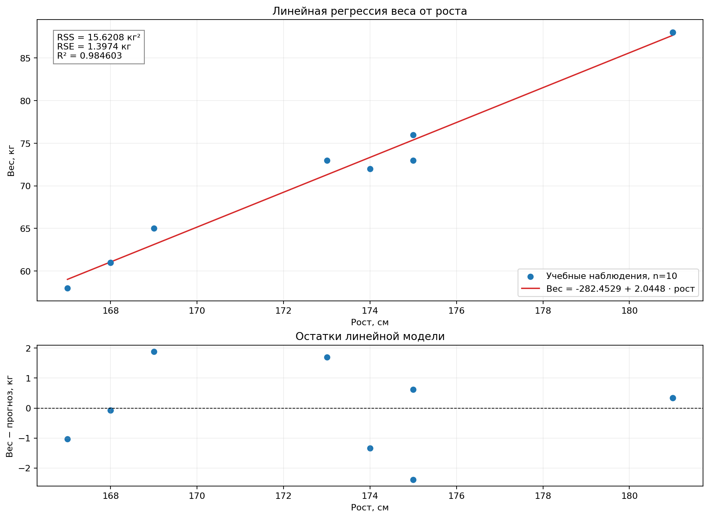
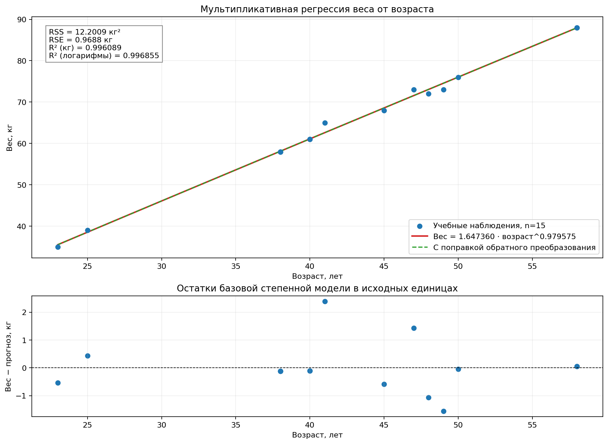

# Лабораторная работа 04_02 — регрессионный анализ

## Условие

1. Составить таблицу, сопоставляющую рост и вес взрослых людей, например членов семьи, друзей, членов учебной группы и т. п. (5–10 человек).
2. Без применения программных средств построить модель простой линейной регрессии зависимости веса от роста. Нанести на график исходные точки и линию регрессии.
3. Вычислить сумму квадратов остатков RSS, стандартную ошибку остатков RSE и корреляционное отношение η² (R²). Сделать выводы о степени адекватности линейной модели.
4. Составить таблицу, сопоставляющую возраст и вес различных людей на примере членов семьи, родственников и знакомых (10–20 значений). В среде программирования R построить мультипликативную модель нелинейной регрессии зависимости веса от возраста. Нанести на график исходные точки и линию регрессии. Оценить адекватность модели.

Источник условия — последний слайд «Лекции 18». **По согласованному варианту программная часть реализована на Python.** Первая часть содержит выкладку для ручного выполнения; программа служит проверкой вычислений и строит иллюстрации. Требование сдачи ручного решения предполагает самостоятельную запись расчётов и построение линии на бумаге.

## План решения

1. На основе генератора из примера подготовить 10 пар «рост — вес» и 15 пар «возраст — вес», сохранить таблицы в CSV.
2. Для линейной модели составить расчётную таблицу, получить коэффициенты по формулам МНК, вычислить остатки, RSS, RSE и R².
3. Для мультипликативной модели применить логарифмирование, оценить линейную зависимость ln(веса) от ln(возраста) и перейти к степенной кривой.
4. Нанести исходные точки и модели на графики, рассмотреть остатки и сделать выводы с учётом происхождения данных.

## Данные и их происхождение

В [примере labs/06](https://github.com/azya0/big_data_2025/tree/main/labs/06) нет таблиц реальных измерений. Используются 500 синтетических значений u из N(0,1), шум ε из N(0,1) и зависимость v=15u−17+ε. У исходных u и v есть отрицательные значения; их нельзя считать ростом, возрастом и весом людей в физических единицах.

Для выбранного варианта **синтетические данные получены из того же генератора**, но приведены к положительным учебным величинам. Это условные наблюдения P01,…,P15, а не измерения родственников или знакомых. Величины рассчитаны следующим образом:

```python
rng = np.random.RandomState(42)
u = rng.normal(0, 1, 500)
v = 15 * u - 17 + rng.normal(0, 1, 500)
height = np.rint(170 + 7 * u[:10])
weight = np.rint(v + 82)
age = np.rint(10 * (u - u.min() + 1))
```

Для первой таблицы взяты первые 10 пар `height, weight`, для второй — первые 15 пар `age, weight`. Округление до целых упрощает ручной расчёт. При построении моделей используются только выбранные 10 и 15 строк, не все 500 исходных точек. Совпадающие значения отдельных условных наблюдений сохранены.

Данные хранятся в [height_weight.csv](data/height_weight.csv) и [age_weight.csv](data/age_weight.csv). Если нужны именно измерения людей по исходному условию, их необходимо заменить фактическими данными, повторить расчёты и обновить текст отчёта.

## Структура и запуск

- `src/main.py` — чтение таблиц, вывод результатов, графики и сохранение показателей.
- `src/part1.py` — линейная регрессия и формулы качества модели.
- `src/part2.py` — мультипликативная регрессия через логарифмирование.
- `data/` — две исходные таблицы.
- `results/metrics.csv` — коэффициенты и показатели в разных шкалах.
- `results/` — два графика с моделями и остатками.

Из корня проекта:

```bash
python -m pip install -r labs/04_02/requirements.txt
.venv/bin/python labs/04_02/src/main.py
```

Запуск сохраняет таблицу показателей и графики, затем открывает окна с изображениями. Для сохранения без окон:

```bash
.venv/bin/python labs/04_02/src/main.py --save
```

При активированном виртуальном окружении вместо `.venv/bin/python` можно писать `python`. Интернет не требуется. При повторном запуске обновляются графики и CSV; текст README автоматически не изменяется.

## 1. Линейная регрессия веса от роста: ручная выкладка

Зависимая переменная y — вес в килограммах, фактор x — рост в сантиметрах. Число наблюдений n=10.

### Расчётная таблица

| Наблюдение | x, см | y, кг | x² | xy |
|---|---:|---:|---:|---:|
| P01 | 173 | 73 | 29929 | 12629 |
| P02 | 169 | 65 | 28561 | 10985 |
| P03 | 175 | 73 | 30625 | 12775 |
| P04 | 181 | 88 | 32761 | 15928 |
| P05 | 168 | 61 | 28224 | 10248 |
| P06 | 168 | 61 | 28224 | 10248 |
| P07 | 181 | 88 | 32761 | 15928 |
| P08 | 175 | 76 | 30625 | 13300 |
| P09 | 167 | 58 | 27889 | 9686 |
| P10 | 174 | 72 | 30276 | 12528 |
| **Сумма** | **1731** | **715** | **299875** | **124255** |

Дополнительно: Σy²=52137, средний рост x̄=173.1 см, средний вес ȳ=71.5 кг.

Ищем модель ŷ=b₀+b₁x. Из нормальных уравнений МНК:

$$
b_1=\frac{n\sum xy-\sum x\sum y}{n\sum x^2-(\sum x)^2}
=\frac{10\cdot124255-1731\cdot715}{10\cdot299875-1731^2}
=\frac{4885}{2389}\approx2.044788614.
$$

$$
b_0=\bar y-b_1\bar x
=71.5-\frac{4885}{2389}\cdot173.1
=-\frac{674780}{2389}\approx-282.452909167.
$$

**Полученная модель:**

$$
\hat y=-282.452909167+2.044788614x.
$$

Для ручного построения нанести 10 исходных точек из таблицы. Линию провести через две рассчитанные точки: **(167; 59.026789)** и **(181; 87.653830)**. Она также проходит через точку средних **(173.1; 71.5)**.

### Остатки и показатели качества

Остаток eᵢ=yᵢ−ŷᵢ. В таблице значения округлены для показа, показатели ниже рассчитаны без промежуточного округления.

| Наблюдение | Прогноз ŷ, кг | Остаток e, кг | e², кг² |
|---|---:|---:|---:|
| P01 | 71.295521 | 1.704479 | 2.905248 |
| P02 | 63.116367 | 1.883633 | 3.548074 |
| P03 | 75.385098 | −2.385098 | 5.688694 |
| P04 | 87.653830 | 0.346170 | 0.119834 |
| P05 | 61.071578 | −0.071578 | 0.005123 |
| P06 | 61.071578 | −0.071578 | 0.005123 |
| P07 | 87.653830 | 0.346170 | 0.119834 |
| P08 | 75.385098 | 0.614902 | 0.378104 |
| P09 | 59.026789 | −1.026789 | 1.054297 |
| P10 | 73.340310 | −1.340310 | 1.796430 |

$$
RSS=\sum_{i=1}^{10}e_i^2=\frac{37318}{2389}\approx15.620761825\ \text{кг}^2.
$$

$$
RSE=\sqrt{\frac{RSS}{n-2}}
=\sqrt{\frac{15.620761825}{8}}
\approx1.397352936\ \text{кг}.
$$

$$
TSS=\sum(y_i-\bar y)^2=\sum y_i^2-\frac{(\sum y_i)^2}{n}
=52137-\frac{715^2}{10}=1014.5\ \text{кг}^2.
$$

$$
\eta^2=R^2=1-\frac{RSS}{TSS}
=1-\frac{15.620761825}{1014.5}\approx0.984602502.
$$

В знаменателе RSE стоит n−2, поскольку оценены два параметра b₀ и b₁. RSS измеряется в кг², RSE — в кг, R² безразмерен.



### Вывод по линейной модели

Модель объясняет примерно **98.46%** вариации веса в выбранной учебной таблице. RSE≈**1.40 кг** мал относительно диапазона весов 58–88 кг; наибольшее абсолютное отклонение составляет около 2.39 кг. Линия хорошо описывает эти 10 точек.

Наклон 2.0448 означает увеличение расчётного веса примерно на 2.04 кг при увеличении роста на 1 см **в пределах этой искусственной выборки**. Высокий R² обусловлен исходной линейной формулой генератора и не доказывает причинную зависимость для людей. Модель не следует применять за пределами диапазона роста 167–181 см; отрицательный свободный член не интерпретируется как вес при нулевом росте.

## 2. Мультипликативная модель веса от возраста

### Таблица возраста и веса

| Наблюдение | Возраст x, лет | Вес y, кг |
|---|---:|---:|
| P01 | 47 | 73 |
| P02 | 41 | 65 |
| P03 | 49 | 73 |
| P04 | 58 | 88 |
| P05 | 40 | 61 |
| P06 | 40 | 61 |
| P07 | 58 | 88 |
| P08 | 50 | 76 |
| P09 | 38 | 58 |
| P10 | 48 | 72 |
| P11 | 38 | 58 |
| P12 | 38 | 58 |
| P13 | 45 | 68 |
| P14 | 23 | 35 |
| P15 | 25 | 39 |

Число наблюдений n=15 соответствует требованию 10–20. Возраст и вес положительны, поэтому логарифмы определены. Это отдельная учебная таблица возраста; измеренные возрасты людей не заявляются.

### Линеаризация модели

По слайду 6 лекции 18 мультипликативная модель имеет вид:

$$
Y=\alpha X^\gamma\varepsilon,\qquad \varepsilon>0.
$$

Вводим V=lnY и Z=lnX:

$$
V=\beta_0+\beta_1 Z+e,\qquad
\beta_0=\ln\alpha,\quad\beta_1=\gamma,\quad e=\ln\varepsilon.
$$

МНК применяется **к логарифмам**, как в примере. Получены:

$$
\hat\beta_0\approx0.499174064,\qquad
\hat\gamma\approx0.979575113,\qquad
\hat\alpha=\exp(\hat\beta_0)\approx1.647360095.
$$

**Базовая степенная кривая:**

$$
\hat y=1.647360095\cdot x^{0.979575113}.
$$

Она показана на графике красным. Кривая строится по плотной упорядоченной сетке возраста, а не ломаной через наблюдения. Внизу изображены остатки y−ŷ в килограммах.



### Адекватность и шкалы расчёта

| Шкала / модель | RSS | RSE | R² |
|---|---:|---:|---:|
| Линейная регрессия ln(веса) на ln(возраста) | 0.002907735 | 0.014955666 | 0.996855462 |
| Базовая степенная кривая, вес в кг | 12.200898224 кг² | 0.968777907 кг | 0.996089121 |
| Кривая с поправкой обратного преобразования, вес в кг | 12.203676857 кг² | 0.968888215 кг | 0.996088231 |

В первой строке ошибки измеряются в логарифмической шкале. Во второй и третьей R² рассчитывается заново по исходному весу: **1−RSS/Σ(y−ȳ)²**. Это не квадрат корреляции логарифмов. RSE в кг приведён как описательная величина √(RSS/(n−2)); он не является стандартной ошибкой логарифмической модели и не используется здесь для доверительных интервалов.

МНК в логарифмах минимизирует RSS логарифмов и не обязан минимизировать RSS в килограммах. Поэтому показатели разных шкал различаются.

### Поправка обратного преобразования

В лекции мультипликативная ошибка ε имеет Eε=1. При этом E(ln ε) обычно не равно нулю. Простое возведение экспоненты от линейного прогноза в логарифмах не гарантирует получение среднего веса. Для оценки среднего в исходной шкале при одинаковом распределении ошибок используется поправка:

$$
C=\frac1n\sum_{i=1}^{n}\exp(e_i)\approx1.000097433,
\qquad
\hat y_{\mathrm{corr}}=C\exp(\hat\beta_0)x^{\hat\gamma}
\approx1.647520603\cdot x^{0.979575113}.
$$

На выбранных данных среднее yᵢ/ŷᵢ,corr равно 1 с точностью округления. Это свойство расчётной поправки, а не доказательство гипотезы о распределении ошибок. Зелёная пунктирная кривая на графике показывает этот вариант; поправка очень мала, поэтому линии почти совпадают. Для сопоставления с примером базовая модель и её показатели сохранены отдельно.

### Вывод по мультипликативной модели

Для исходного веса **R²≈0.9961**, RSE≈**0.97 кг**. Степенная кривая хорошо описывает выбранные 15 учебных наблюдений и объясняет около **99.61%** вариации их веса. Показатель γ≈0.98 близок к 1, поэтому на рассматриваемом диапазоне кривая близка к линейной.

Высокое качество заложено в синтетических данных: и возраст, и вес получены из одной исходной переменной генератора. Эти результаты не доказывают рост веса реального человека с возрастом и не учитывают пол, рост и другие факторы. Нельзя экстраполировать кривую за диапазон 23–58 лет.

## 3. Сопоставление с лекцией и примером

Сохранены формулы линейной регрессии, расчёты RSS, RSE и R² и логарифмический способ построения степенной модели из [исходного кода](https://github.com/azya0/big_data_2025/tree/main/labs/06/src). Программа на Python разделена на `main.py`, `part1.py` и `part2.py`, как в примере.

Различия, существенные для задания:

1. В примере регрессии строятся по 500 абстрактным точкам, хотя печатаются только первые пять. Здесь используются таблицы из 10 и 15 строк, соответствующие указанным размерам выборок.
2. Данные примера преобразованы и обозначены как синтетические учебные величины; их происхождение не скрывается.
3. Для первой части дана расчётная таблица и полная выкладка, пригодная для выполнения на бумаге. Программный расчёт является проверкой.
4. Для нелинейной модели отдельно вычислены показатели в логарифмах и исходных единицах, показаны остатки и поправка обратного преобразования.
5. Нельзя сравнивать R² первой и второй частей как критерий выбора лучшей модели: различаются факторы и состав таблиц. Текстовый вывод примера о меньшем R² степенной модели не переносится автоматически на другую выборку.

Адекватность не сводится к одному высокому R²: полезен анализ остатков, как описано в [справочнике NIST](https://www.itl.nist.gov/div898/handbook/pmd/section4/pmd44.htm). Здесь показаны остатки обеих моделей, но малые синтетические выборки не дают оснований делать выводы о закономерностях для населения.

## Что показывать при сдаче

1. Первую таблицу, ручной расчёт b₀ и b₁ и построенную на бумаге линию.
2. RSS=15.6208 кг², RSE=1.3974 кг и R²=0.9846; вывод по линейной модели.
3. Вторую таблицу, уравнение степенной модели и график 02.
4. R²=0.9961 и RSE=0.9688 кг для базовой степенной кривой; пояснение различия исходной и логарифмической шкал.
5. Происхождение данных и ограничения выводов. В согласованном варианте использованы Python и синтетические данные примера; буквальное требование R и реальные измерения людей этим вариантом не воспроизводятся.

Числовые результаты также сохранены в [metrics.csv](results/metrics.csv).
