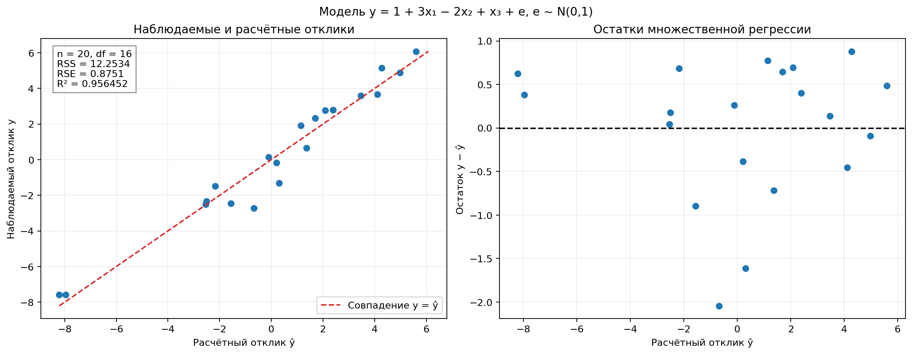
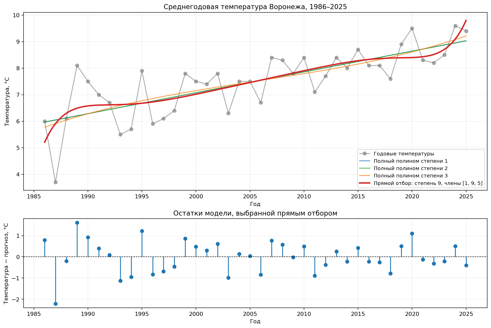
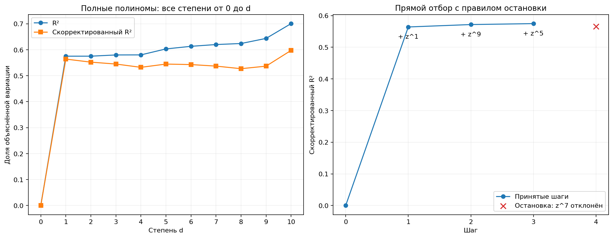

# Лабораторная работа 05 — множественная и полиномиальная регрессия

## Условие

1. Рассмотреть зависимость

   $$y=1+3x_1-2x_2+x_3+e,\qquad e\sim N(0,1).$$

   Сгенерировать 20 различных измерений вектора факторов (x₁ₖ,x₂ₖ,x₃ₖ), вычислить соответствующие отклики yₖ и построить множественную линейную регрессию.
2. Вычислить сумму квадратов остатков RSS, стандартную ошибку остатков RSE и корреляционное отношение η² (R²). Сделать выводы о степени адекватности модели.
3. На сайте «Погода и климат» найти 20–40 среднегодовых температур **Воронежа**. Построить полиномиальные линейные регрессии температуры от времени и реализовать процедуру прямого отбора при выборе степени полинома.

Вариант соответствует уточнению к последнему слайду «Лекции 20»: 20 измерений и 20–40 годовых температур выбранного города. Программа реализована на Python, структура основана на [примере labs/07](https://github.com/azya0/big_data_2025/tree/main/labs/07).

## План решения

1. Сгенерировать 20 векторов факторов и независимый нормальный шум с фиксированным seed.
2. Оценить МНК свободный член и коэффициенты при трёх факторах, сравнить с исходной формулой.
3. Вычислить RSS, RSE, R², скорректированный R² и общий F-критерий; рассмотреть остатки.
4. Загрузить 40 годовых температур Воронежа за 1986–2025 годы и построить полные полиномы степеней 0–10.
5. Выполнить прямой отбор степеней с правилом остановки, сохранить все шаги и построить графики.

## Структура и запуск

- `task1.py` — генерация данных, множественная регрессия, полная таблица измерений и сводка OLS.
- `task2.py` — коэффициенты, показатели качества и график множественной регрессии; использует модель из `task1.py`.
- `task3.py` — полиномиальные модели температуры, прямой отбор и его графики.
- `weather_parser.py` — загрузка и проверка среднегодовых температур.
- `data/voronezh_annual.csv` — 40 температур с адресом источника и датой загрузки.
- `results/` — таблицы показателей, коэффициентов и шагов отбора, три изображения.

Из корня проекта установить зависимости:

```bash
python -m pip install -r labs/05/requirements.txt
```

Запуск заданий 1–2 с графиком:

```bash
.venv/bin/python labs/05/task2.py
```

Запуск задания 3 с двумя графиками:

```bash
.venv/bin/python labs/05/task3.py
```

Для сохранения графиков без открытия окон добавить `--save`. При активированном виртуальном окружении вместо `.venv/bin/python` можно использовать `python`.

Дополнительно:

- `.venv/bin/python labs/05/task1.py` — вывести 20 измерений и подробную сводку множественной регрессии.
- `.venv/bin/python labs/05/weather_parser.py` — проверить сохранённую таблицу температур или скачать её при отсутствии файла.
- `.venv/bin/python labs/05/weather_parser.py --refresh` — повторно загрузить температуры из источника.

При наличии CSV с температурами вычисления работают без интернета. Повторные запуски обновляют таблицы и изображения; README автоматически не перезаписывается.

## 1. Модельные измерения и множественная регрессия

Использован **seed=18022004**, как в примере. Факторы x₁,x₂,x₃ независимо генерируются из N(0,1), поскольку их распределение условием не задано. Затем отдельно генерируются 20 значений e из N(0,1). Все 20 векторов факторов различны; матрица со свободным членом имеет ранг 4.

### Сгенерированные данные

Значения в таблице округлены до шести знаков. В [model_sample.csv](results/model_sample.csv) сохранены исходные числа, шум, расчётные отклики и остатки; для оценки модели используется полная точность.

| k | x₁ | x₂ | x₃ | y |
|---:|---:|---:|---:|---:|
| 1 | 0.610480 | −0.333319 | −1.693820 | 0.644774 |
| 2 | 0.505167 | 1.309647 | 0.719019 | −1.311625 |
| 3 | −0.491833 | 0.182942 | −1.080351 | −2.326246 |
| 4 | −0.220023 | 0.526814 | −0.374349 | −2.456334 |
| 5 | −1.163783 | 0.095951 | 0.494578 | −2.497287 |
| 6 | 0.168412 | −0.672727 | −2.389007 | 0.155385 |
| 7 | 1.490425 | −0.122617 | −1.175915 | 5.163424 |
| 8 | −2.465106 | 0.413419 | −0.241929 | −7.580389 |
| 9 | 0.038822 | −1.017454 | 1.579464 | 4.882235 |
| 10 | −1.730442 | 2.087464 | 1.105183 | −7.586319 |
| 11 | 0.818931 | 0.504810 | 0.167738 | 2.798494 |
| 12 | 0.350750 | −0.071293 | 0.078473 | 2.778625 |
| 13 | 1.390071 | 1.444451 | 1.287746 | 3.603288 |
| 14 | −0.965085 | −0.951032 | −0.394444 | −2.722646 |
| 15 | −0.194192 | −0.349716 | −0.574993 | −0.179515 |
| 16 | 1.211245 | −0.734287 | −0.465536 | 6.083259 |
| 17 | −0.732025 | 0.113967 | −0.303754 | −1.492454 |
| 18 | 0.566318 | 0.165778 | 1.645614 | 3.660464 |
| 19 | −1.071345 | −1.936210 | 0.060129 | 2.337255 |
| 20 | 0.126800 | 0.786195 | 1.457446 | 1.916221 |

### Оценённое уравнение

МНК применяется к матрице с четырьмя столбцами: 1, x₁, x₂, x₃. Оценки вычисляются библиотечной процедурой OLS без явного обращения матрицы XᵀX.

$$
\hat y=0.733786736+3.141541999x_1-2.196818655x_2+1.192870501x_3.
$$

| Коэффициент | Истинное значение | Оценка |
|---|---:|---:|
| β₀ | 1 | 0.733786736 |
| β₁ | 3 | 3.141541999 |
| β₂ | −2 | −2.196818655 |
| β₃ | 1 | 1.192870501 |

Оценки отличаются от истинных значений из-за случайного шума и малого размера выборки. Точное совпадение коэффициентов в зашумлённых данных не требуется.

## 2. RSS, RSE и η²

При n=20 и p=3 факторах число степеней свободы остатков равно **n−p−1=16**. Свободный член является четвёртым оцениваемым коэффициентом.

$$
RSS=\sum_{k=1}^{20}(y_k-\hat y_k)^2,
\qquad RSE=\sqrt{\frac{RSS}{20-3-1}},
\qquad \eta^2=R^2=1-\frac{RSS}{\sum_k(y_k-\bar y)^2}.
$$

Скорректированный коэффициент детерминации:

$$
\bar R^2=1-(1-R^2)\frac{n-1}{n-p-1}.
$$

| Показатель | Значение |
|---|---:|
| RSS | 12.253370632 |
| RSE | 0.875120371 |
| R² = η² | 0.956452329 |
| Скорректированный R² | 0.948287141 |
| Общая F-статистика, df=(3,16) | 117.137816097 |
| p-значение общего F-критерия | 4.23344·10⁻¹¹ |

Числа также сохранены в [multiple_metrics.csv](results/multiple_metrics.csv).



Слева показана близость наблюдений к линии y=ŷ, справа — остатки относительно расчётного отклика. Трёхфакторную регрессионную поверхность нельзя полностью изобразить обычной линией на плоскости, поэтому используются эти диагностические графики.

**Вывод:** модель объясняет около **95.65%** вариации сгенерированного отклика, а RSE≈0.875 сопоставима с заданным стандартным отклонением шума 1. Общий F-критерий отвергает гипотезу β₁=β₂=β₃=0 при уровне 0.05. Модель хорошо описывает выбранную реализацию данных, что согласуется с линейным законом генерации. Высокий R² сам по себе не доказывает независимость или нормальность остатков и не гарантирует такую же точность на новых данных.

## 3. Среднегодовые температуры Воронежа

Источник: [«Погода и климат», средние месячные и годовые температуры Воронежа](https://www.pogodaiklimat.ru/history/34123.htm), станция **34123**. При обращении к каталогу `file.htm` из условия получен ответ 404, поэтому использована действующая таблица на том же сайте, как и в парсере примера.

Выбраны **40 последовательных полных лет, 1986–2025**. Взято опубликованное значение столбца **«за год»**, а не температура отдельного месяца и не самостоятельно рассчитанное среднее месячных значений. Неполный 2026 год не включён. Пропусков, повторов и маркеров 999.9 нет; интерполяция и удаление отдельных наблюдений не применялись. Дата загрузки — **26.10.2026**. Данные и метаданные доступны в [voronezh_annual.csv](data/voronezh_annual.csv).

| Год | Температура, °C | Год | Температура, °C |
|---:|---:|---:|---:|
| 1986 | 6.0 | 2006 | 6.7 |
| 1987 | 3.7 | 2007 | 8.4 |
| 1988 | 6.1 | 2008 | 8.3 |
| 1989 | 8.1 | 2009 | 7.8 |
| 1990 | 7.5 | 2010 | 8.4 |
| 1991 | 7.0 | 2011 | 7.1 |
| 1992 | 6.7 | 2012 | 7.7 |
| 1993 | 5.5 | 2013 | 8.4 |
| 1994 | 5.7 | 2014 | 8.0 |
| 1995 | 7.9 | 2015 | 8.7 |
| 1996 | 5.9 | 2016 | 8.1 |
| 1997 | 6.1 | 2017 | 8.1 |
| 1998 | 6.4 | 2018 | 7.6 |
| 1999 | 7.8 | 2019 | 8.9 |
| 2000 | 7.5 | 2020 | 9.5 |
| 2001 | 7.4 | 2021 | 8.3 |
| 2002 | 7.8 | 2022 | 8.2 |
| 2003 | 6.3 | 2023 | 8.5 |
| 2004 | 7.5 | 2024 | 9.6 |
| 2005 | 7.5 | 2025 | 9.4 |

### Полиномиальные линейные модели

Для устойчивого вычисления степеней вводится масштабированное время:

$$
z=\frac{t-2005.5}{19.5},\qquad -1\le z\le1.
$$

Модели остаются **линейными по коэффициентам**, хотя зависят от времени нелинейно:

$$
T=\beta_0+\beta_1z+\beta_2z^2+\cdots+\beta_dz^d+e.
$$

Масштабирование меняет базис и коэффициенты, но не пространство полиномов по календарному году. Прямое использование t¹⁰ при годах около 2000 приводило бы к крайне большим числам и плохой обусловленности матрицы.

Построены полные полиномы степеней 0–10. Степень 0 — модель только со свободным членом.

| Полная степень d | RSS, °C² | RSE, °C | R² | Скорректированный R² |
|---:|---:|---:|---:|---:|
| 0 | 57.189750 | 1.210952 | 0.000000 | 0.000000 |
| 1 | 24.290770 | 0.799519 | 0.575260 | 0.564083 |
| 2 | 24.290029 | 0.810239 | 0.575273 | 0.552315 |
| 3 | 24.019037 | 0.816820 | 0.580012 | 0.545012 |
| 4 | 24.004844 | 0.828162 | 0.580260 | 0.532289 |
| 5 | 22.690788 | 0.816931 | 0.603237 | 0.544889 |
| 6 | 22.118092 | 0.818685 | 0.613251 | 0.542933 |
| 7 | 21.724380 | 0.823946 | 0.620135 | 0.537040 |
| 8 | 21.498778 | 0.832772 | 0.624080 | 0.527068 |
| 9 | 20.374652 | 0.824109 | 0.643736 | 0.536857 |
| 10 | 17.115542 | 0.768239 | 0.700724 | 0.597525 |

Полная таблица, включая AIC и BIC, — [polynomial_models.csv](results/polynomial_models.csv).

## 4. Прямой отбор

Процедура соответствует схеме из лекции:

1. Начать с нулевой модели T=β₀, без факторов времени.
2. По очереди попробовать добавить каждый из ещё не выбранных членов z¹,…,z¹⁰.
3. Выбрать кандидата с наименьшим RSS. Поскольку все кандидаты данного шага имеют одинаковое число коэффициентов, это также кандидат с наибольшим скорректированным R².
4. Принять его, только если скорректированный R² больше текущего более чем на 10⁻¹⁰. Иначе остановиться и оставить предыдущую модель.

Порог 10⁻¹⁰ служит для сравнения чисел с учётом округления. **Это правило улучшения качества с поправкой на сложность, а не тест значимости с уровнем 0.05.** Признаки после добавления не удаляются. Максимально допустимая степень равна 10, но программа не обязана включать все десять членов.

### Шаги процедуры

| Шаг | Предлагаемый член | RSS кандидата, °C² | R² кандидата | Скорректированный R² | Решение |
|---:|---|---:|---:|---:|---|
| 0 | Только свободный член | 57.189750 | 0.000000 | 0.000000 | Начальная модель |
| 1 | z | 24.290770 | 0.575260 | 0.564083 | Принять |
| 2 | z⁹ | 23.236408 | 0.593696 | 0.571734 | Принять |
| 3 | z⁵ | 22.453405 | 0.607388 | 0.574670 | Принять |
| 4 | z⁷ | 22.282817 | 0.610370 | 0.565841 | Отклонить, остановиться |

На четвёртом шаге RSS уменьшился, но после штрафа за дополнительный коэффициент качество ухудшилось. Поэтому член z⁷ **не входит** в окончательную модель. История с флагами принятия находится в [forward_selection.csv](results/forward_selection.csv).

### Выбранная модель

Порядок добавления членов: **z, z⁹, z⁵**. Упорядоченное по степеням уравнение:

$$
\hat T=7.5025+1.741870928z-2.768226026z^5+3.323811401z^9,
\qquad z=\frac{t-2005.5}{19.5}.
$$

Это **полином степени 9 с тремя выбранными факторами и свободным членом**, а не полный полином девятой степени и не полином третьей степени. Нижние степени не добавляются автоматически: как в примере и общей схеме прямого отбора, рассматриваются отдельные степенные признаки. Все коэффициенты, центр и масштаб сохранены в [selected_coefficients.csv](results/selected_coefficients.csv).

| Показатель выбранной модели | Значение |
|---|---:|
| Число годовых наблюдений | 40 |
| Число факторов p | 3 |
| Число коэффициентов со свободным членом | 4 |
| Степени свободы остатков | 36 |
| RSS | 22.453405231 °C² |
| RSE = √(RSS/36) | 0.789750404 °C |
| R² | 0.607387596 |
| Скорректированный R² | 0.574669896 |
| AIC | 98.417595826 |
| BIC | 105.173113643 |

При вычислении RSE число факторов определяется **количеством выбранных членов**, а не наибольшей степенью. Здесь делитель равен 40−3−1=36.





### Выводы по температуре и выбору модели

Выбранная модель объясняет около **60.74%** вариации температур на рассматриваемом отрезке; RSE≈**0.79 °C**. На фоне общего повышения температуры сохраняются заметные межгодовые отклонения. Высокая степень кривой не означает, что все погодные колебания объяснены.

Обычный R² не уменьшается при добавлении членов, поэтому его рост сам по себе не является достаточным основанием для повышения степени. Прямой отбор остановился после трёх принятых шагов, хотя следующий член немного уменьшал RSS.

**Прямой отбор — жадная процедура и не гарантирует глобально лучшую модель.** В частности, полный полином степени 10 имеет скорректированный R²=0.597525, выше, чем 0.574670 у выбранной модели. Он не достигается по принятой траектории, потому что очередное одиночное добавление ухудшает критерий. По AIC и BIC среди полных полиномов предпочтительнее степень 1; это другие критерии с другой ценой сложности. Вывод о выбранной степени всегда нужно связывать с указанной процедурой и правилом остановки.

Степенной отбор зависит от выбора базиса и интервала наблюдений. Высокие степени могут давать неустойчивое поведение у границ; выбранную кривую нельзя использовать для прогноза за пределами 1986–2025 годов без отдельной проверки. Остатки годовых температур могут быть зависимы во времени, поэтому подгонка OLS здесь рассматривается как описание ряда, а не доказательство климатической причинности. Доверительные интервалы и тесты после отбора в этой работе не заявляются.

## 5. Сравнение с лекцией и примером

Сохранены модель отклика, нормальные факторы и шум, seed=18022004, OLS, формулы RSS/RSE/R², загрузка столбца «за год», центрирование времени и прямой отбор степенных признаков из [примера](https://github.com/azya0/big_data_2025/tree/main/labs/07).

В реализации учтены следующие различия:

- `task1.py` примера по умолчанию использует **200** наблюдений. Здесь ровно **20**, как в задании. Из-за другого размера выборки совпадения численных коэффициентов с запуском примера на 200 точках не ожидается.
- Выбран именно **Воронеж**, 40 полных годовых значений. Источник, период и дата загрузки сохранены вместе с данными.
- В примере прямой отбор выбирает очередного кандидата по скорректированному R² и добавляет все 10 признаков без проверки улучшения. Здесь перебор соответствует минимуму RSS из лекции и имеет явное правило остановки.
- Степени времени масштабированы к [−1,1], что улучшает обусловленность расчёта; маркеры пропусков не участвуют в регрессии.
- Сохранены принятые и отклонённый шаги, полный набор моделей степеней 0–10 и коэффициенты окончательного полинома.

## Что показывать при сдаче

1. Таблицу 20 измерений и оценённое уравнение с четырьмя коэффициентами.
2. RSS=12.2534, RSE=0.8751, R²=0.9565 и график 01.
3. Таблицу 40 температур Воронежа и источник данных.
4. График 02 — исходные температуры, несколько полиномов и остатки выбранной модели.
5. Таблицу прямого отбора и график 03: приняты степени 1, 9, 5; степень 7 на следующем шаге отклонена. Окончательная степень — **9**, число выбранных степенных факторов — **3**.
