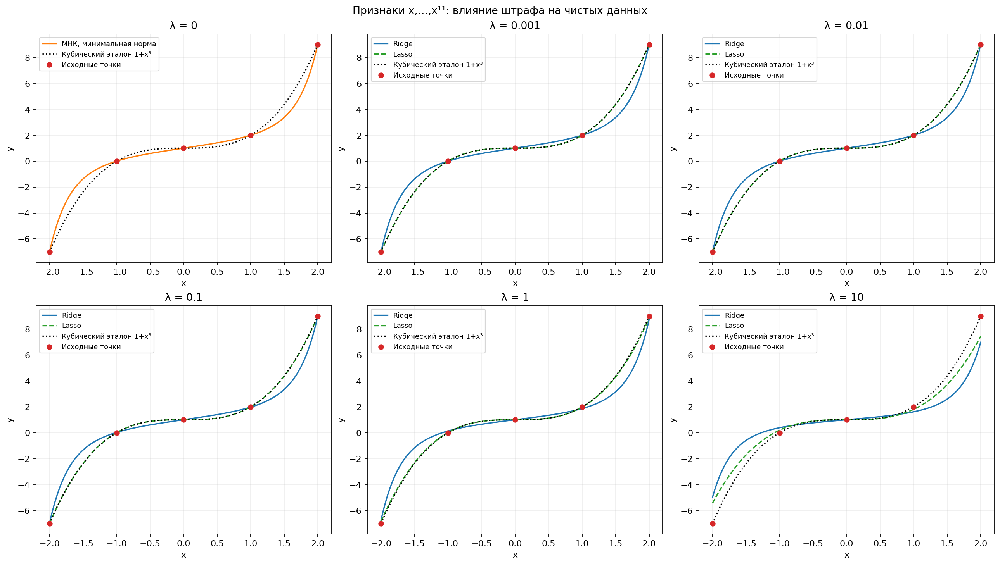
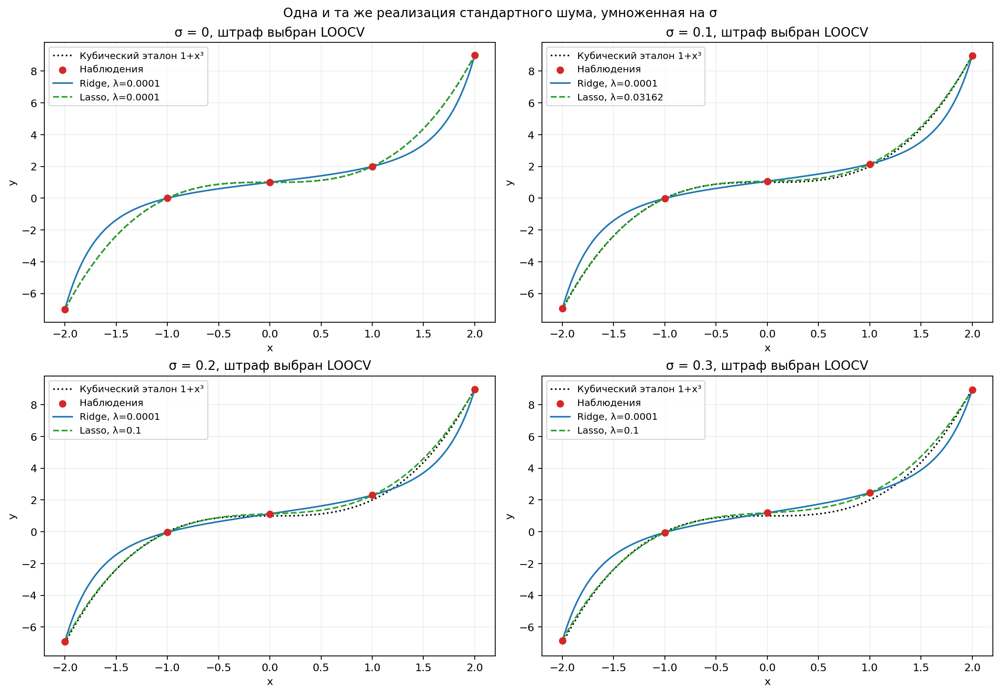
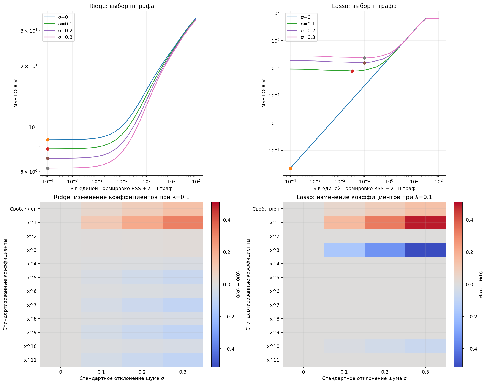

# Лабораторная работа 06 — гребневая и лассо-регрессия

## Условие

1. Строго вывести решения задач из примера 3 для гребневой и лассо-регрессий.
2. Для точек **(−2,−7), (−1,0), (0,1), (1,2), (2,9)** построить регрессионные полиномы степени p=11 методами Ridge и Lasso. Сделать выводы о значимых факторах, структуре модели и приемлемом коэффициенте штрафа.
3. Добавить к отклику нормальный шум с нулевым средним и стандартными отклонениями **0.1, 0.2, 0.3**. Повторить построение моделей и проанализировать влияние шума на оценки коэффициентов.

Постановка сверена с примерами 3 и заданием на слайдах 11 и 14 **«Лекции 22»**. Программная часть реализована на Python, за основу структуры взят [пример labs/08](https://github.com/azya0/big_data_2025/tree/main/labs/08).

## План решения

1. Использовать независимость координат при X=I, вывести минимум Ridge и условия минимума Lasso через субдифференциал.
2. Построить признаки x,…,x¹¹, стандартизовать их и оценивать свободный член отдельно без штрафа.
3. Сравнить 25 положительных значений штрафа, выбрать минимум ошибки перекрёстной проверки с исключением одной точки (LOOCV).
4. Повторить эксперимент для трёх уровней шума, сохранить все коэффициенты и показатели качества.
5. Отдельно сравнить изменения коэффициентов при фиксированном штрафе, чтобы не смешивать влияние шума и смену параметра регуляризации.

## Структура и запуск

- [formula.md](formula.md) — строгий вывод решений задач из примера 3.
- `src/base.py` — построение моделей, перевод коэффициентов в исходные единицы, проверка условий оптимальности и LOOCV.
- `src/main.py` — вычислительный эксперимент, сохранение таблиц и вывод результатов.
- `src/plot.py` — три итоговых изображения.
- [data/points.csv](data/points.csv) — пять исходных точек.
- `results/` — графики, реализации шума, все коэффициенты и показатели.

Из корня проекта:

```bash
.venv/bin/python -m pip install -r labs/06/requirements.txt
.venv/bin/python labs/06/src/main.py
```

Программа выполняет расчёты, сохраняет CSV и графики, затем открывает окна с изображениями. Для сохранения без окон:

```bash
.venv/bin/python labs/06/src/main.py --save
```

При активированном виртуальном окружении вместо `.venv/bin/python` можно использовать `python`. Интернет для расчётов не требуется. Повторный запуск воспроизводит эксперимент и обновляет результаты; текст README и formula.md автоматически не изменяется.

## 1. Аналитическое решение примера 3

Предположения: **n=p, X=Iₚ, β₀=0, λ≥0**. Для цели RSS+λ·штраф получаем:

$$
\hat\beta_j^{(R)}=\frac{y_j}{1+\lambda},\qquad
\hat\beta_j^{(L)}=\operatorname{sign}(y_j)\max\bigl(|y_j|-\lambda/2,0\bigr).
$$

В [строгом выводе](formula.md) обоснованы существование и единственность минимумов, рассмотрены положительная и отрицательная области, точка b=0, границы |y|=λ/2 и случай λ=0. Для Lasso используется **∂f(0)=−2y+[−λ,λ]**, а не просто [−λ,λ].

Покоординатные формулы применимы к единичной матрице. У полиномиальных признаков столбцы зависимы, поэтому в последующих заданиях решается общая численная задача.

## 2. Данные, модель и ограничения

| x | y |
|---:|---:|
| −2 | −7 |
| −1 | 0 |
| 0 | 1 |
| 1 | 2 |
| 2 | 9 |

Рассматривается семейство:

$$
f(x)=\beta_0+\beta_1x+\cdots+\beta_{11}x^{11}.
$$

При пяти наблюдениях имеется **12 коэффициентов**. Матрица с константой имеет ранг 5; однозначного решения обычной МНК по коэффициентам нет. Согласованная с точками модель минимальной степени — **f₀(x)=1+x³**. Она служит кубическим эталоном на рисунках, однако одни только пять точек не доказывают, что именно она является истинной зависимостью между узлами.

Например, q(x)=x(x²−1)(x²−4) обращается в ноль во всех пяти узлах. Поэтому

$$
1+x^3+q(x)r(x),\qquad \deg r\le6,
$$

тоже интерполирует исходные данные и может иметь степень до 11. Регуляризация выбирает решение на основе штрафа, а не устраняет недостаток информации. На графике при λ=0 показана одна МНК-модель минимальной нормы в стандартизованных координатах; она не является единственно возможной интерполяцией. Параметр Lasso при λ=0 не используется.

### Стандартизация и штраф

Для каждого степенного признака обучающая выборка определяет среднее mⱼ и стандартное отклонение sⱼ. В модель подаются Zⱼ=(xʲ−mⱼ)/sⱼ. При такой шкале высокие степени не получают преимущество только из-за больших значений, например 2¹¹=2048. Свободный член включается один раз: `PolynomialFeatures(include_bias=False)` и отдельный intercept.

Во всех экспериментах используются цели:

$$
Q_R=\sum_i(y_i-b_0-Z_i\theta)^2+\lambda\sum_j\theta_j^2,
\qquad
Q_L=\sum_i(y_i-b_0-Z_i\theta)^2+\lambda\sum_j|\theta_j|.
$$

Штраф применяется к стандартизованным θ, свободный член b₀ не штрафуется. Перевод обратно в исходный полином:

$$
\beta_j=\theta_j/s_j\quad(j\ge1),\qquad
\beta_0=b_0-\sum_j\theta_jm_j/s_j.
$$

**Стандартизация меняет смысл штрафа на исходные коэффициенты**, поэтому численные рекомендации по λ нельзя переносить из модели без стандартизации. Малый коэффициент при высокой степени также не обязательно означает малый вклад: его нужно умножить на xʲ.

Ridge решается через SVD. Для Lasso используется алгоритм LARS (`LassoLars`), решающий ту же задачу с L1-штрафом. В пробном координатном спуске при малых штрафах наблюдалась медленная сходимость из-за зависимых признаков; LARS позволил получить решения, прошедшие проверку условий оптимальности. Предупреждения о сходимости не скрываются.

Нормировки библиотечных параметров учтены явно: **α_Ridge=λ**, **α_Lasso=λ/(2n)**. При пяти обучающих точках α_Lasso=λ/10. Подробности и ссылки на документацию приведены в [formula.md](formula.md#3-применимость-формул-и-нормировка).

## 3. Выбор приемлемого штрафа

Проверяется логарифмическая сетка из **25 значений λ от 10⁻⁴ до 10²**. Для каждого метода и каждого уровня шума выполняется LOOCV: модель обучается на четырёх точках и прогнозирует пятую, затем берётся среднее пяти квадратов ошибок. Стандартизация каждый раз обучается **только на четырёх обучающих точках**, чтобы не использовать информацию из контрольной точки.

Выбирается минимум **MSE LOOCV на заданной сетке**. На этапе из четырёх точек для той же цели RSS+λ·L1 используется α_Lasso=λ/8. При минимуме на границе сетки программа сообщает об этом: такое значение нельзя объявлять точным внутренним оптимумом непрерывного диапазона.

Дополнительно вычисляется MSE относительно кубического эталона на 401 точке [−2,2]. Эта величина служит иллюстрацией поведения между узлами и **не используется для выбора λ**. Поле называется `reference_mse`, чтобы не смешивать его с ошибкой на независимых реальных наблюдениях.

### Модели без шума

| Метод | λ по LOOCV | RSS на пяти точках | MSE LOOCV | MSE по кубическому эталону | Ненулевые степени |
|---|---:|---:|---:|---:|---|
| Ridge | 0.0001 | 2.72672·10⁻⁹ | 8.617375 | 0.377566 | 1, 3, 5, 7, 9, 11 |
| Lasso | 0.0001 | 5.00000·10⁻¹⁰ | 5.03034·10⁻¹⁰ | 3.56941·10⁻¹¹ | 3 |

Оба минимума находятся на нижней границе сетки. При уменьшении λ на чистых данных Lasso приближается к кубическому эталону; положительный штраф даёт небольшое стягивание коэффициента. Для Ridge уменьшение ошибки в обучающих узлах не гарантирует восстановления кубической формы между ними.

Коэффициенты в исходных единицах при выбранных λ:

| Степень | Ridge | Lasso |
|---:|---:|---:|
| 0 | 1.000000000 | 1.000000000 |
| 1 | 0.771870460 | 0 |
| 2 | ≈0 | 0 |
| 3 | 0.174820438 | 0.999998039 |
| 4 | ≈0 | 0 |
| 5 | 0.040369983 | 0 |
| 6 | ≈0 | 0 |
| 7 | 0.009853088 | 0 |
| 8 | ≈0 | 0 |
| 9 | 0.002447872 | 0 |
| 10 | ≈0 | 0 |
| 11 | 0.000610999 | 0 |

Поэтому чистая Lasso-модель практически равна **1+0.999998039x³**, тогда как Ridge распределяет вклад между несколькими нечётными степенями. Нулевые чётные коэффициенты Ridge здесь следуют из симметрии данных, а не из механизма отбора L2-штрафом. В общем случае Ridge не зануляет коэффициенты точно.

Для подсчёта активных факторов используется порог **|θⱼ|>10⁻⁷** в стандартизованных координатах. Ненулевой коэффициент означает включение фактора алгоритмом, а не доказанную статистическую значимость: p-значения для такого утверждения не рассчитываются. Семейство признаков остаётся p=11, даже если эффективная степень Lasso после зануления старших коэффициентов равна 3.



Кривые показаны внутри диапазона исходных x, без искусственного ограничения вертикальной оси. При больших штрафах усиливается недообучение: коэффициенты уменьшаются, прогнозы стягиваются к константе.

## 4. Добавление нормального шума

Использован **seed=42**. Сначала генерируется один вектор zᵢ из N(0,1), затем yᵢ(σ)=yᵢ+σzᵢ. При каждом σ шум имеет требуемое распределение N(0,σ²), а использование одной реализации позволяет сравнивать влияние амплитуды шума. Разные уровни шума при этом зависимы между собой; это не четыре независимых эксперимента. Эмпирическое среднее пяти значений шума не обязано равняться нулю.

| x | Без шума | σ=0.1 | σ=0.2 | σ=0.3 |
|---:|---:|---:|---:|---:|
| −2 | −7 | −6.950329 | −6.900657 | −6.850986 |
| −1 | 0 | −0.013826 | −0.027653 | −0.041479 |
| 0 | 1 | 1.064769 | 1.129538 | 1.194307 |
| 1 | 2 | 2.152303 | 2.304606 | 2.456909 |
| 2 | 9 | 8.976585 | 8.953169 | 8.929754 |

Полная точность исходных откликов и добавленного шума сохранена в [samples.csv](results/samples.csv).

### Выбор штрафа при шуме

| σ | Метод | Выбранное λ | MSE LOOCV | RSS | Ненулевые степени без свободного члена |
|---:|---|---:|---:|---:|---|
| 0.1 | Ridge | 0.0001 | 7.768275 | 4.02585·10⁻⁹ | 1–11 |
| 0.1 | Lasso | 0.0316228 | 0.00588015 | 0.000115104 | 1, 3, 10 |
| 0.2 | Ridge | 0.0001 | 6.973059 | 5.82485·10⁻⁹ | 1–11 |
| 0.2 | Lasso | 0.1 | 0.02350199 | 0.001069219 | 1, 3, 10 |
| 0.3 | Ridge | 0.0001 | 6.231726 | 8.12373·10⁻⁹ | 1–11 |
| 0.3 | Lasso | 0.1 | 0.05250657 | 0.001137405 | 1, 3, 10 |

Для Ridge минимум остаётся на нижней границе сетки, при этом качество LOOCV существенно хуже, чем у Lasso. Это результат конкретного малого набора и выбранной стандартизации, а не универсальное преимущество одного метода.

Для Lasso в этой реализации приемлемые значения, выбранные проверкой, — **λ≈0.0316 при σ=0.1** и **λ=0.1 при σ=0.2–0.3**. Соответствующие параметры scikit-learn на пяти точках равны примерно 0.00316 и 0.01. Рекомендации относятся к указанной нормировке, сетке и данным; они не являются общими диапазонами для любых задач.

При шуме Lasso добавляет x и x¹⁰ и уменьшает коэффициент при x³. Например, при σ=0.3:

$$
\hat f_L(x)\approx1.195170946+0.346891249x
+0.897654252x^3-0.000140170864x^{10}.
$$

Слагаемое x¹⁰ отражает подгонку этой реализации возмущений; его появление не доказывает наличие десятой степени в исходном законе. Даже малый коэффициент при x¹⁰ даёт заметный вклад у |x|=2. При пяти точках состав выбранных степеней может быть чувствителен к шуму.



### Влияние шума при одинаковом штрафе

Чтобы отделить изменение данных от выбора λ, дополнительно сравним коэффициенты при **фиксированном λ=0.1**. В таблице приведены отдельные коэффициенты исходного полинома и норма изменения всего вектора β₀,…,β₁₁ относительно чистого случая при том же λ.

| Метод | σ | β₀ | β₁ | β₃ | β₁₀ | ‖β(σ)−β(0)‖₂ |
|---|---:|---:|---:|---:|---:|---:|
| Ridge | 0 | 1.000000 | 0.748224 | 0.173826 | ≈0 | 0 |
| Ridge | 0.1 | 1.066714 | 0.822581 | 0.174680 | −0.000017001 | 0.099943 |
| Ridge | 0.2 | 1.133427 | 0.896938 | 0.175533 | −0.000034001 | 0.199886 |
| Ridge | 0.3 | 1.200141 | 0.971294 | 0.176386 | −0.000051002 | 0.299828 |
| Lasso | 0 | 1.000000 | 0 | 0.998039 | 0 | 0 |
| Lasso | 0.1 | 1.059605 | 0.113204 | 0.965212 | −0.000033426 | 0.132082 |
| Lasso | 0.2 | 1.127388 | 0.230048 | 0.931433 | −0.000086798 | 0.271267 |
| Lasso | 0.3 | 1.195171 | 0.346891 | 0.897654 | −0.000140171 | 0.410490 |

При фиксированных признаках и λ Ridge линейно зависит от отклика, поэтому для одной реализации шума изменение коэффициентов растёт пропорционально σ. Lasso зависит от отклика кусочно-линейно и может менять активный набор. В выполненном эксперименте отклонение коэффициентов обоих методов от чистого случая увеличивается с σ.



Сверху — MSE LOOCV для всех уровней шума. Внизу — изменения стандартизованных коэффициентов θ относительно чистого случая; свободный член указан в центрированных координатах. Общая цветовая шкала позволяет сравнить изменения вкладов степенных факторов. Исходные β, соответствующие таблице выше, сохранены отдельно в CSV.

Уменьшение MSE LOOCV Ridge при росте σ в этой реализации не означает, что шум улучшает оценку в среднем. Оно может быть следствием случайного взаимодействия возмущений и смещения модели. По одной реализации нельзя оценить среднюю дисперсию коэффициентов или доказать универсальное преимущество метода.

## 5. Общие выводы

1. В примере X=I гребневая регрессия даёт непрерывное стягивание y/(1+λ), а Lasso — мягкое пороговое преобразование с порогом λ/2.
2. По пяти наблюдениям нельзя однозначно восстановить 12 коэффициентов степени 11. Штраф задаёт предпочтение среди допустимых моделей, и его эффект зависит от масштаба признаков.
3. На чистых данных стандартизованный Lasso выделяет x³ и свободный член, восстанавливая кубическую модель с небольшим смещением. Ridge сохраняет несколько нечётных степеней и почти интерполирует узлы, но отличается между ними.
4. При добавлении шума меняются свободный член, коэффициенты и активные степени. Регуляризация не гарантирует правильного распознавания каждого структурного члена при столь малой выборке.
5. Для выбора штрафа полезна контрольная ошибка, а не только RSS или почти единичный обучающий R². В LOOCV крайние точки прогнозируются за пределами диапазона оставшихся четырёх точек, поэтому с пятью наблюдениями оценка качества особенно нестабильна. Прогнозы вне [−2,2] в работе не обосновываются.

## 6. Сравнение с лекцией и примером

Сохранены исходные точки, степень 11, методы Ridge/Lasso, seed=42 и все три стандартных отклонения шума. Проверены аналитическая постановка примера 3 и задание из PDF.

Существенные уточнения относительно [исходного кода](https://github.com/azya0/big_data_2025/tree/main/labs/08/src):

- В исходном `formula.md` промежуточный субградиент и значение функции в ненулевом минимуме записаны с ошибками. Наш [вывод](formula.md) исправляет эти шаги и доказывает единственность решения.
- В примере `PolynomialFeatures` включает константу, а часть функций вывода смещает номера коэффициентов и не показывает последний. Здесь константа отделена, степени 0–11 выводятся без сдвига; сохранены все 12 коэффициентов для каждого случая.
- Учтены разные нормировки `alpha` у Ridge и Lasso, введена стандартизация. Поэтому диапазоны штрафов из README примера не копируются как готовая рекомендация.
- При λ=0 показана только МНК-модель; Lasso с нулевым штрафом не запускается. Оптимальность численных решений проверяется условиями ККТ, а не отсутствием предупреждения.
- Таблицы коэффициентов охватывают все σ, а не отдельную дополнительную реализацию только при σ=0.1. Для контролируемого сравнения уровней используется один вектор стандартного шума.
- При p>n основная проблема — неидентифицируемость и возможность переобучения. Утверждать обязательный эффект Рунге для любого решения МНК по этим пяти точкам было бы некорректно.

## Сохранённые таблицы и проверка

- [metrics.csv](results/metrics.csv) — 200 сочетаний уровня шума, метода и штрафа: RSS, R², LOOCV, ошибка по эталону, активные члены, изменение коэффициентов и нарушение ККТ.
- [coefficients.csv](results/coefficients.csv) — 2400 строк: степени 0–11 в исходных и стандартизованных координатах для всех случаев. Числа не округлены для показа.
- [selected_models.csv](results/selected_models.csv) — восемь моделей с минимальным MSE LOOCV на сетке.
- [samples.csv](results/samples.csv) — чистые и зашумлённые отклики.

Максимальное нарушение условий оптимальности среди 200 итоговых Ridge/Lasso-моделей составило около **2.85·10⁻¹⁴**. Проверяются также свободный член и решения внутри перекрёстной проверки. Выполнение условий ККТ для выпуклой задачи подтверждает глобальную оптимальность численного решения в указанной нормировке; при вырожденной матрице это не всегда означает единственность коэффициентов Lasso.

## Что показывать при сдаче

1. Строгий вывод из [formula.md](formula.md), особенно субградиент в нуле и порог λ/2.
2. График 01 и таблицу чистых коэффициентов — отличие стягивания Ridge от отбора Lasso.
3. График 02 и таблицу выбранных штрафов — все три уровня шума.
4. График 03 и сравнение при фиксированном λ — влияние шума на коэффициенты.
5. Вывод об ограниченности информации при пяти точках и о зависимости выбора штрафа от нормировки и процедуры проверки.
